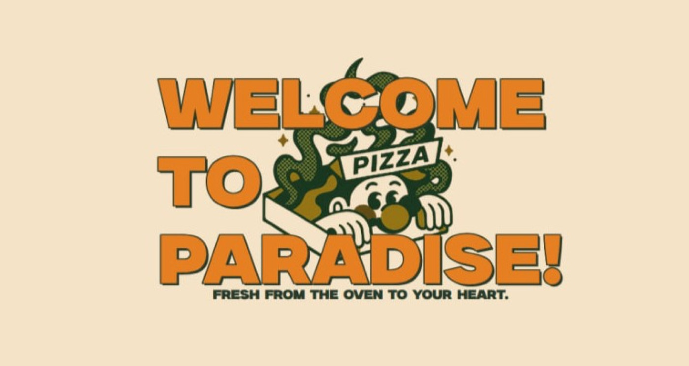

# Pizza Paradise: Restaurant Page

A single-page restaurant site with **Home**, **Menu** and **Contact** tabs, rendered entirely with JavaScript. Part of the [The Odin Project](https://www.theodinproject.com/) JavaScript curriculum.

**▶ Live demo:** https://liza-uchaneva.github.io/RestaurantPage_TheOdinProject/



## What I practiced

- Building the whole page through DOM manipulation: `index.html` is only a shell
- **ES modules**: each tab (`home.js`, `menu.js`, `contact.js`) exports a function that renders its content
- Tab switching without page reloads
- Bundling with **Webpack** (HTML plugin, CSS loaders, dev server) and deploying the `dist` folder to GitHub Pages

## Running locally

```bash
npm install
npx webpack serve
```
